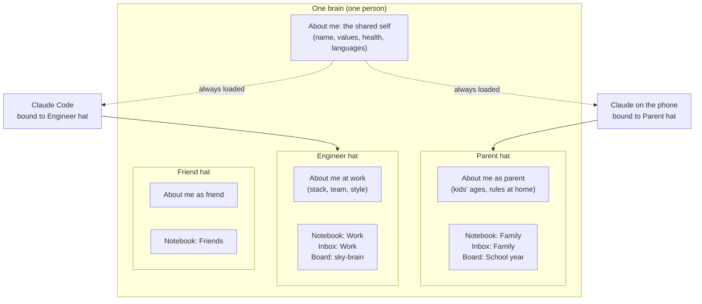
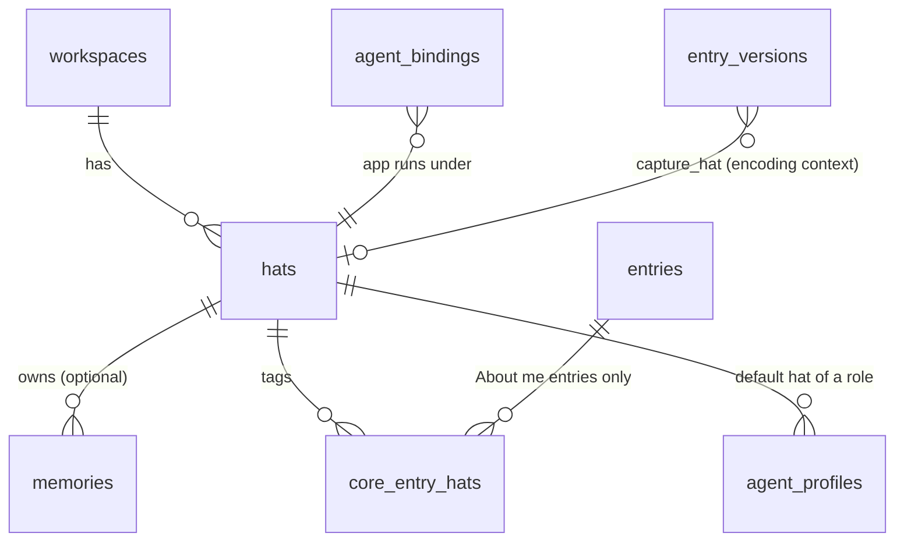
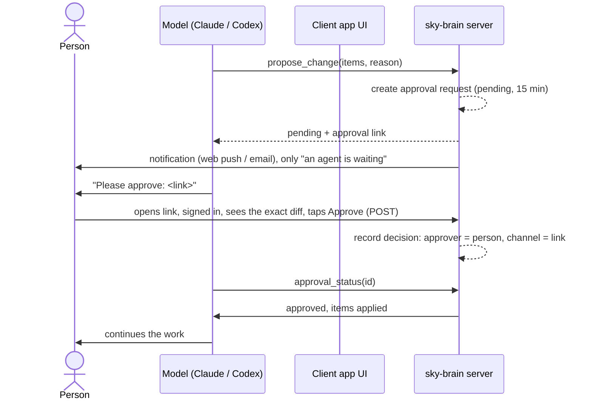
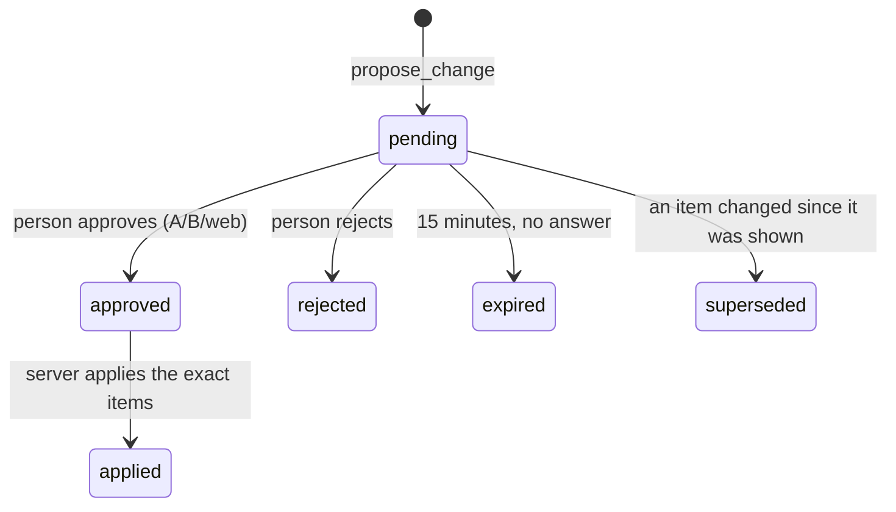
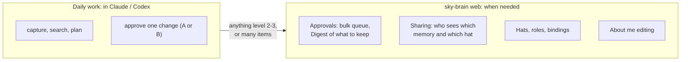

# Hats and approval through the model

**Status:** design agreed with shammai, 24 Nov 2026, not built. D30 (hats) and D31
(approval through the connected model) in [`docs/DECISIONS.md`](../DECISIONS.md).

It answers two ideas shammai raised on 24 Nov 2026:

1. **Hats.** A person is one person, with one brain and one About me, but they live in several
   identities: parent, friend, professional. Each identity has its own context. A model connected
   under the parent hat should meet About me *as the parent*, and so should every other model
   that does parenting work.
2. **Approval through the model.** The person works in Claude or Codex. The model proposes what
   it wants to save or change, the person approves right there, and the model carries on. The web
   app stops being where daily work happens and becomes the place for bulk approval and for
   letting other people into chosen parts of the brain.

It builds on [MEMORY-SCHEMA.md](schema/MEMORY-SCHEMA.md) (one core per person, sharing per
memory), [AGENTS.md](AGENTS.md) (profiles bound per connected app, D26; scopes, skills and
triggers, D25) and the hard rules in [CLAUDE.md](../../CLAUDE.md).

---

## Part 1. Hats

### The idea in one picture

- **One brain, one About me.** Hats do not split the person into several brains. Some things are
  true in every role (your name, your values, your languages, that you prefer short
  answers), and those stay in the shared part of About me.
- **A hat is a lens on the same brain.** It decides which part of About me an agent sees, which
  memories it may read and write, and where its captures land.
- **The hat comes from the binding, never from the agent.** Like the role (D26), the person binds
  each connected app to a hat on the web. An agent cannot pick or switch its own hat.

### Why this is grounded in psychology

| Finding | What it means here |
| --- | --- |
| **Self-aspects and self-complexity** (Linville 1985, 1987; McConnell 2011, Multiple Self-Aspects Framework). The self is organized as several context-bound self-aspects (me as parent, me at work) that share some attributes and not others. | A hat is a self-aspect. About me has a shared part and a per-hat part, and one entry can belong to more than one hat. |
| **The working self-concept** (Markus & Wurf 1987). Only part of the self-concept is active at a time, and the context decides which part. | The context packet loads the shared About me plus the active hat's part, not everything. Smaller, more relevant context. |
| **Role identity theory** (Stryker 1968; Burke & Stets 2009). Each role carries its own meanings and expectations, and roles have different salience. | Each hat has its own description and its own rules, which become that hat's rules in the packet. |
| **Encoding specificity and context-dependent memory** (Tulving & Thomson 1973; Godden & Baddeley 1975). Recall is best when the retrieval context matches the encoding context. | Every capture stores the hat it was made under (principle 4 in [HUMAN-MEMORY.md](HUMAN-MEMORY.md): store the encoding context). Search ranks same-hat items higher. |
| **Compartmentalization vs integration** (Showers 1992; Campbell 1996, self-concept clarity). Fully walled-off selves hurt; a clear, integrated self with distinct roles helps. | Hats scope by default but the person can bridge them: mark an entry as shared or as belonging to two hats. Nothing is lost between roles. |

### The model

- **Table `hats`:** `id`, `workspace_id`, `slug`, `name` (Parent, Engineer, Friend), `description`
  (how this hat talks and decides, written by the person), `color`, `created_at`. The person
  writes them; agents never do (hard rule 3). A brain starts with no hats, which behaves exactly
  as today.
- **Memories get an optional `hat_id`.** "Family" notebook, "Family" inbox and the "School year"
  board belong to Parent. A memory without a hat is **shared across hats** (readable under every
  hat the person allows). The hat is a property of the container, not of each entry. This keeps
  the rule from MEMORY-SCHEMA section 6: entries never move, and sharing is per memory.
- **About me stays one memory** (one core per person, still enforced). Its entries get
  `core_entry_hats` rows: none means shared self, one or more means "true about me in these
  roles". Only the person writes these rows.
- **Every new entry version records `capture_hat`**, the hat of the binding that wrote it. It is
  provenance, not a permission: it feeds ranking and the byline ("Parent · Claude on phone").
- **The binding gains a hat.** `agent_bindings` gets `hat_id`. The person sets "Claude on my
  phone: Parent hat, PO role". `agent_profiles` gets an optional default hat for templates.

### What a hat changes at run time

| | No hat (today) | Under the Parent hat |
| --- | --- | --- |
| About me in the packet | All core entries | Shared core entries + entries tagged Parent |
| Search and `list_memories` | All readable memories | Memories of the Parent hat + shared memories |
| Where `capture` lands | The default Inbox | The Parent hat's Inbox (created with the hat) |
| Rules in the packet | Approved rules | Approved rules that are shared or tagged Parent |
| Byline | `mcp/claude.ai/po` | `mcp/claude.ai/po` · Parent |

The check is one more term in the existing "lowest of" rule from AGENTS.md: the effective right
of a call is the lowest of the person's role in the memory, the run token's role, the profile's
scope **and the hat's reach**. A hat can only narrow; it never grants anything the person lacks.

### Lens and wall: two jobs a hat does

The security and UX review (24 Nov 2026) split a hat into two jobs, and they need different
protection:

- **The lens** (soft): which part of About me is in the packet, how search ranks, where captures
  land, which rules show. A lens never widens what can be read, so it may be picked per chat, even
  by the person just saying "I'm at work" and the model passing `hat: "work"` on a call.
- **The wall** (hard): what can be read and written at all. A wall must come from the token, never
  from anything the model sends (hard rule 2). Only the wall needs its own connector.

A person who only wants focus uses one connector and lenses. A person who wants "work data is
never readable from a family chat" puts a wall around a hat.

### One app, several hats (the wall)

D26 binds one role per app. For a walled hat, the person adds sky-brain once more, at
`https://sky-brain.vercel.app/mcp/h/<hat-id>`. What makes this a real wall:

1. **Each hat path is its own OAuth resource.** Protected resource metadata is served per path
   (`/.well-known/oauth-protected-resource/mcp/h/<hat-id>`), with `resource` set to that exact URL.
   Claude sends the RFC 8707 `resource` parameter with the path included, so the token's audience
   is that hat. Today the audience is fixed at `<PUBLIC_URL>/mcp` (`auth/auth.ts`), so a token is
   valid on every path; that has to change.
2. **The audience must equal the path, on every call.** A token minted for `/mcp/h/parent` and sent
   to `/mcp/h/work` gets 401. The binding is keyed by `(person, client, audience)`, taken from the
   verified token. It cannot be keyed by client id: under Client ID Metadata Documents (CIMD) every
   claude.ai connector has the same client id.
3. **Consent is asked again per hat** and names the hat ("Claude wants to work as you, Parent").
4. **Each hat path reports its own `serverInfo.name`** (`sky-brain-parent`). claude.ai merges
   connectors that report the same name, even at different URLs (reported bug).
5. **Opaque hat ids in the URL**, not slugs: a URL ends up in client logs, and a hat name like
   "divorce" should not. An unknown hat and another person's hat give the same 404. Neither is a
   secret, so hard rule 5 holds.
6. **Once a person has any walled hat, the plain `/mcp` connector and run tokens see shared
   memories only**, not everything.

What the person has to know (from the client research):

- claude.ai, Claude Desktop and the phone app share one connector list; connectors are added on
  the web. Each can be switched on or off per chat from "+" > Connectors. If both hats are on in
  one chat, the model holds both walls' reach, so the web setup card says "turn on one hat per chat".
- **The claude.ai Free plan allows only one custom connector**, and on Team and Enterprise only an
  owner adds them. Walls are therefore a paid-plan or Claude Code feature; lenses work everywhere.
- Claude Code: `claude mcp add --transport http parent <url>` per hat, or a project's `.mcp.json`
  pointing at the work hat, so a repo always works under its hat.
- The web gives an "Add the Parent hat to Claude" card with the URL, a suggested name
  ("sky-brain: Parent") and the hat's colour. `whoami` and every tool result say "under Parent".

**No model-callable switch that widens reads.** An earlier draft had `switch_hat` with the
person's consent. It is dropped: MCP here is stateless, so there is no conversation to switch, and
a switch would widen every open chat in that app at once. Lenses cover the focus need without it.

### Leaks the design closes

- **Derived entries take the narrowest hat of their sources.** Gists, merges, links and Digest
  cards made from a Parent item stay Parent. The Consolidator never merges across walled hats.
- Stewards and run tokens get a hat like any binding; without one they see shared memories only.
- Bylines and link titles shown in a shared memory never name a walled hat's content.

### Starting with no hats, and suggestions (shammai, 24 Nov)

A new brain starts with **no hats**, which behaves exactly as today. sky-brain suggests hats once
it has something to go on:

- The Consolidator (a steward) notices a clear cluster, for example 15 or more captures about
  school and the kids, and writes a **Digest card**: "18 of your notes are about school and the
  kids. Make a Parent hat?" The card lists the memories that would get the hat, and offers Create,
  Not now and Never.
- The card shows in the web's Digest and in a "Suggested hats" strip on About me, at most once a
  week, never in a chat. An agent may also *propose* a hat through the approval flow (level 3, web
  only); it never creates one.
- A short list of examples (Family, Work, Friends, Health) is offered on the empty hats page as
  one-tap starting points, so the person sees what a hat is without being given any.

### Hats and sharing other people in

Hats make sharing easy to talk about ("let my team into my Engineer hat") but they do not become
a new kind of grant. MEMORY-SCHEMA section 6 already refused tag and layer grants, because a grant
on a label silently shares what is added later. So "Share my Engineer hat" in the UI writes one
grant per memory of that hat that exists now, and the share dialog lists them. A new memory under
the hat asks "share with the same people?" once.

About me is still never shared. The `in_profile` flag (a slice of About me shown to people who
share something with you) becomes per hat: your team sees the Engineer slice of your profile, your
family sees the Parent slice.

### For organizations

In an organization the Professional hat is usually where the organization's memories live. The
member's other hats stay private and never mix with the organization's brain. Nothing changes in
the org design; hats only make that boundary visible to the member.

---

## Part 2. Approval through the connected model

### The goal

The person should rarely need to open sky-brain. They work in Claude or Codex. When the model
wants to save a decision, approve a goal, keep an Inbox item as a Notebook entry or edit About me,
it shows the person what it wants, the person says yes with one tap, and the model continues.

### The danger: a model approving itself

Hard rule 3 says agents cannot approve. That rule stays. What changes is the **channel**: the
person approves, through their own app, and the server must be sure the "yes" came from the person
and not from the model.

Things that do **not** prove a person said yes, so the server never accepts them:

- **The model saying so.** "The user approved" in a tool argument is text the model wrote. A
  prompt injection in a web page or a shared note can make a model write it.
- **A tool the model can call.** An `approve(id)` tool is self-approval with extra steps.
- **A code shown in the chat.** The model can read it and pass it back.

The approval answer has to travel on a path the model cannot write to.

### The channels

The research of 24 Nov 2026 changed the order. MCP elicitation is not ready to carry approvals:
claude.ai web, Desktop and the phone app do not support it; on our stateless connection it cannot
work at all before the 2026-07-28 protocol (multi round-trip requests, "MRTR"); and in Claude Code
a hook can answer an elicitation, so a form "accept" does not prove a person clicked. So the
approval itself always happens on a sky-brain page in the person's own session, and the other
channels only bring the person there.

| Channel | How the person answers | Why the model cannot fake it | Where it works |
| --- | --- | --- | --- |
| **A. Approval link** | `propose_change` returns a short link, `sky-brain.vercel.app/a/<id>`. The person opens it, sees the exact diff signed in, and taps Approve. | The decision is a POST from the person's own browser session. The model never holds it. | Every client |
| **B. URL-mode elicitation** (later) | The client itself opens the same link (the spec makes the client show the full URL and keep it from the model). | Same as A. | Clients that support it (Claude Code, VS Code; claude.ai not yet) |
| **C. Form elicitation** (low trust) | The client shows "Approve these 3 changes?" | Only as strong as the client: hooks can answer it. | Opt-in per binding, level 1 only, never level 2 |

Each approval records `approver = the person`, `channel` (`web`, `link`, `elicitation-url:<client>`,
`elicitation-form:<client>`) and the binding that asked.

### Telling the person an approval is waiting

The model shows the link in the chat, but the person may be away. Research of 24 Nov 2026, in
order of what to build:

| Option | Desktop | Android | iPhone | Approve button in the alert | Effort | Cost |
| --- | --- | --- | --- | --- | --- | --- |
| **Approvals inbox on the web**, live toasts while a tab is open | yes | yes | yes | buttons on the page | 1 to 2 days | $0 |
| **Email** with a link to the confirm page | yes | yes | yes | no | 2 days | about $0 to $20 a month |
| **Web push** (Chrome, Edge, Firefox, Safari; service worker + `web-push` on Vercel) | yes | yes | only after "Add to Home Screen" | Chrome, Edge, Firefox: yes. Safari and iPhone: tap opens the page | 3 to 5 days | $0 |
| **Telegram bot** with buttons | yes | yes | yes | yes | 3 days | $0 |
| Chrome extension | Chrome only | no | no | yes | 1 to 2 weeks + store review | $5 |
| WhatsApp, SMS | | | | | | per message; skip |

Recommendation: the inbox and email first, then web push, then Telegram if people ask for it. Skip
the Chrome extension: web push already gives Chrome real system notifications, with buttons, and
the extension does nothing on phones. A `window.open` popup is blocked by browsers without a click,
so it is not an alert channel.

Rules for every alert:

- **The text is generic** ("An agent is waiting for your approval in Family"). A lock screen shows
  whatever the notification says, so no entry content goes in it.
- **A link never approves by itself.** Mail scanners (Microsoft Safe Links among them) open links
  and even run their scripts. The link opens a confirm page; only a POST from a signed-in session,
  with a CSRF check, changes anything. No token in the URL (hard rule 5), only the request id.
- **An Approve button inside a notification** (Chrome, Edge, Firefox) is allowed for level 1 only.
  The service worker sends a same-origin POST with the session cookie; if the session expired, it
  opens the page instead.
- **Level 2 needs a passkey** (WebAuthn, user verification required) on top of the session.
- **Single use and short-lived:** each request is approved once, expires in 15 to 60 minutes, and
  stores a hash of what was shown. A replay does nothing.

### What needs which channel

Not every change deserves a stop. The levels follow the risk in hard rule 3 and D22:

| Level | Examples | How it is approved |
| --- | --- | --- |
| **0. No approval** | `capture` into the hat's Inbox (lands as `proposed`), notes on the board of a task the agent holds | None; it is already a proposal. |
| **1. Confirm in the app** | Approve a draft goal or new tasks, keep an Inbox item into a Notebook, accept a link | A, an Approve button in a push alert, or C if the binding allows it |
| **2. Confirm with the person's own session** | Edit About me, release a quarantined entry, raise trust, delete, change rules | A with a passkey, never C or an alert button |
| **3. Web only** | Sharing: grants, invites, hats, bindings, profiles, scopes | The web app; never through a model |

Sharing stays web-only on purpose. It is the one action that moves text to a wider audience
(the flow rule in MEMORY-SCHEMA section 6), and the person should see who they are letting in on a
screen sky-brain fully controls.

### The approval request

- **Table `approval_requests`:** `id`, `workspace_id`, `requested_by` (actor, profile, hat),
  `level`, `items` (entry versions, goal ids, task ids, each pinned to the version shown), `reason`
  (the model's one line), `status`, `channel`, `decided_by`, `decided_at`, `expires_at`.
- **What you see is what is applied.** Items are pinned to versions. If anything changed between
  showing and approving, the request is `superseded`, never applied to the newer text.
- **Batch.** One request can hold many items, with "approve all" and per-item untick. The same
  request shows on the web's Approvals page, so the person can also clear the queue there.
- **Limits.** At most N open requests per binding and a cap per hour, so a looping model cannot
  flood the person with prompts (approval fatigue is itself an attack).
- **The model waits without holding the server.** sky-brain's MCP runs stateless on Vercel, so the
  server cannot keep a tool call open for minutes. `propose_change` returns `pending` and the link
  at once; the model calls `approval_status(id)` (cheap, read-only) when the person says done. With
  the 2026-07-28 protocol, an `input_required` result could later carry the URL elicitation; its
  `requestState` is signed and bound to the person, and single use is still enforced in the
  database.

### The web app's new job

### What changes in the rules

- Hard rule 3 gets one clarifying sentence, not a weaker rule: "An agent may *ask* for approval.
  The answer must come from the person through a channel the agent cannot write to (the web, an
  approval link opened in the person's session, or, for level 1 only, a form elicitation in a
  client the person allowed). A tool argument or chat text is never an approval."
- Every approval path needs an allowed test and a refused test, including: a model passing
  `approved: true`, a request approved by another person's session, a superseded item, an expired
  request, and level 2 through form elicitation (refused).

---

## Build order (suggested)

1. **Approval requests, channel A and the web Approvals inbox**, with email alerts. Works in every
   client today. About 1 week.
2. **Web push** with Approve buttons for level 1 on desktop, and an "Add to Home Screen" guide for
   iPhone. About 1 week.
3. **Hats as lenses:** table, hat on memories and bindings, packet and search filters, capture
   routing. No new connector needed.
4. **Walled hats:** OAuth resource and audience per `/mcp/h/<hat-id>`, binding by audience,
   consent per hat, `serverInfo.name` per hat. Needs a spike on claude.ai first (duplicate host,
   merge bug, plan limits).
5. **Hat suggestions** from the Consolidator (with step 6).
6. **Elicitation** (URL mode, then form mode for level 1) once the clients support it and the MCP
   SDK speaks the 2026-07-28 protocol; this is a coordinated upgrade with the pinned auth packages.
7. **Per-hat profile slices** and "share this hat" in the share dialog (with step 8 sharing).

Each step ships with tests and a `docs/PLAN.md` update in the same PR. Like D25, none of this
changes the step 3 measurement, so it can start in parallel.

## Decided

By shammai, 24 Nov 2026:

- A new brain starts with no hats, and sky-brain suggests them.
- One connector per hat is acceptable, after research.
- A hat is a focus lens by default. A wall (its own connector and token audience) is an option for
  the person who wants it.
- The level table stands.
- Alerts: the web Approvals inbox and email first, then web push. Telegram only if people ask.

Still open: nothing blocking. The walled-hat spike on claude.ai comes before build step 4.
