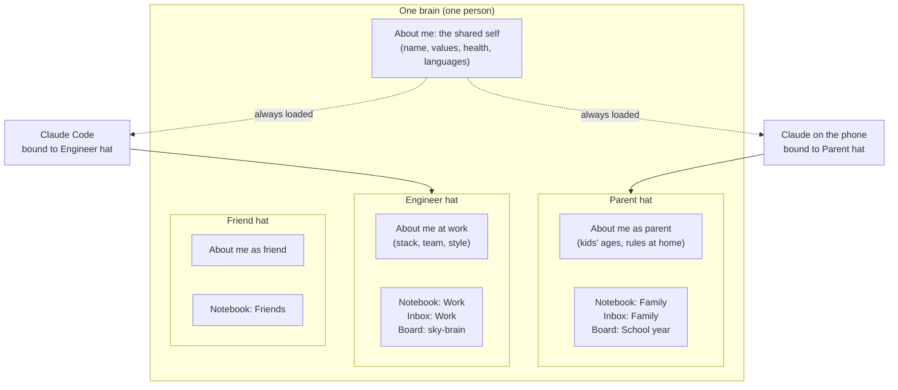
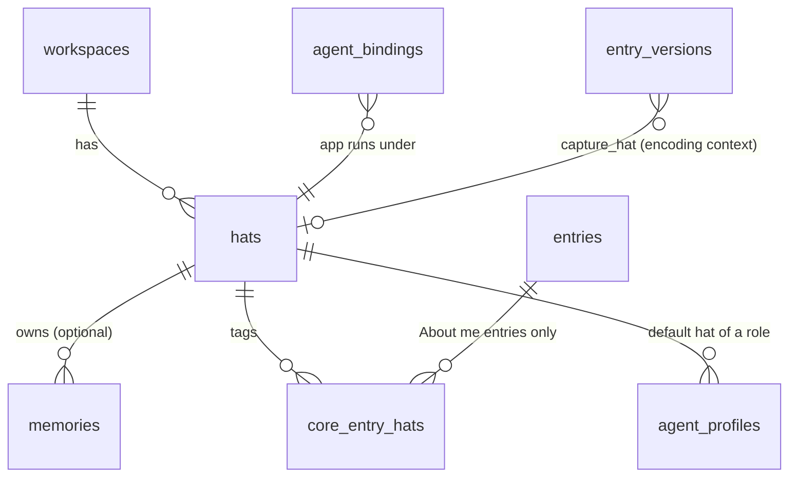
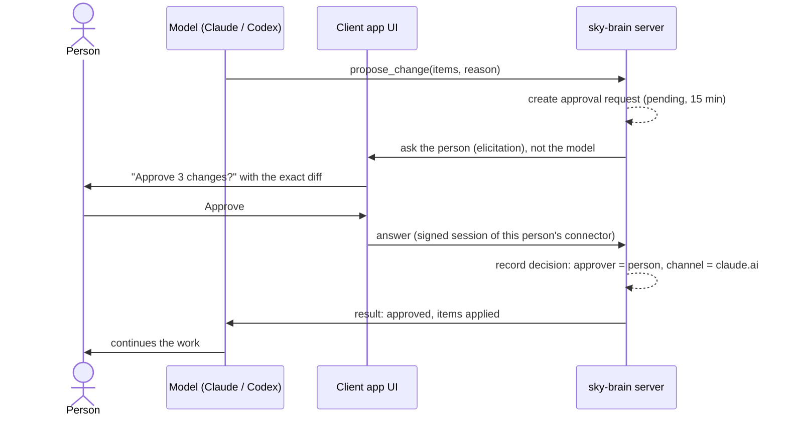
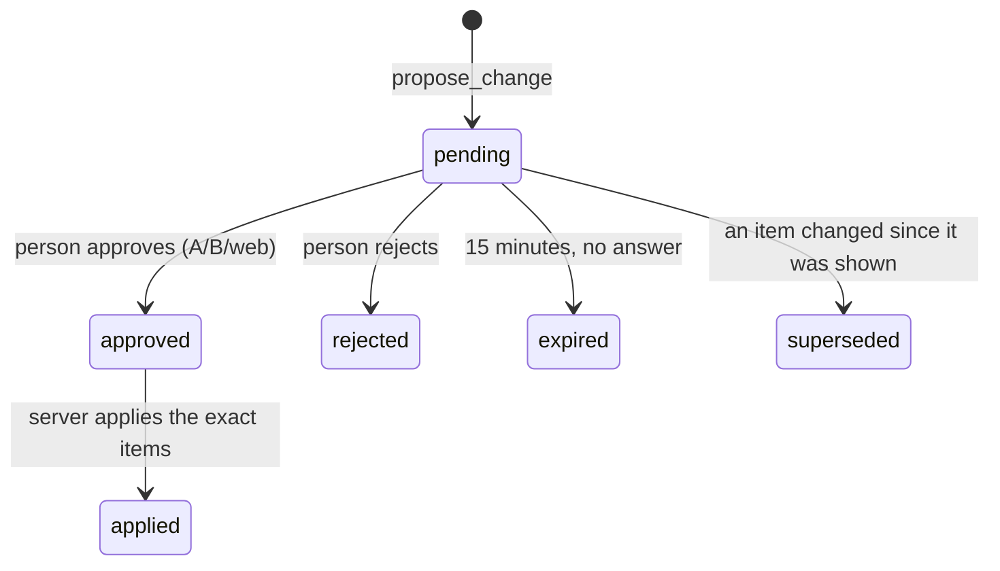
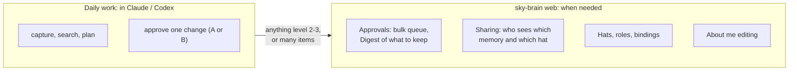

# Hats and approval through the model

**Status:** proposal, 24 Nov 2026. Nothing here is built or decided. Open as D30 (hats) and D31
(approval through the connected model) in [`docs/DECISIONS.md`](../DECISIONS.md).

It answers two ideas shammai raised on 24 Nov 2026:

1. **Hats.** A person is one person, with one brain and one About me, but they live in several
   identities: parent, friend, professional. Each identity has its own context. A model connected
   under the parent hat should meet About me *as the parent*, and so should every other model
   that does parenting work.
2. **Approval through the model.** The person works in Claude or Codex. The model proposes what
   it wants to save or change, the person approves right there, and the model carries on. The web
   app stops being where daily work happens and becomes the place for bulk approval and for
   letting other people into chosen parts of the brain.

It builds on [MEMORY-SCHEMA.md](schema/MEMORY-SCHEMA.md) (one core per person, sharing per
memory), [AGENTS.md](AGENTS.md) (profiles bound per connected app, D26; scopes, skills and
triggers, D25) and the hard rules in [CLAUDE.md](../../CLAUDE.md).

---

## Part 1. Hats

### The idea in one picture

- **One brain, one About me.** Hats do not split the person into several brains. Some things are
  true in every role (your name, your values, your languages, that you prefer short
  answers), and those stay in the shared part of About me.
- **A hat is a lens on the same brain.** It decides which part of About me an agent sees, which
  memories it may read and write, and where its captures land.
- **The hat comes from the binding, never from the agent.** Like the role (D26), the person binds
  each connected app to a hat on the web. An agent cannot pick or switch its own hat.

### Why this is grounded in psychology

| Finding | What it means here |
| --- | --- |
| **Self-aspects and self-complexity** (Linville 1985, 1987; McConnell 2011, Multiple Self-Aspects Framework). The self is organized as several context-bound self-aspects (me as parent, me at work) that share some attributes and not others. | A hat is a self-aspect. About me has a shared part and a per-hat part, and one entry can belong to more than one hat. |
| **The working self-concept** (Markus & Wurf 1987). Only part of the self-concept is active at a time, and the context decides which part. | The context packet loads the shared About me plus the active hat's part, not everything. Smaller, more relevant context. |
| **Role identity theory** (Stryker 1968; Burke & Stets 2009). Each role carries its own meanings and expectations, and roles have different salience. | Each hat has its own description and its own rules, which become that hat's rules in the packet. |
| **Encoding specificity and context-dependent memory** (Tulving & Thomson 1973; Godden & Baddeley 1975). Recall is best when the retrieval context matches the encoding context. | Every capture stores the hat it was made under (principle 4 in [HUMAN-MEMORY.md](HUMAN-MEMORY.md): store the encoding context). Search ranks same-hat items higher. |
| **Compartmentalization vs integration** (Showers 1992; Campbell 1996, self-concept clarity). Fully walled-off selves hurt; a clear, integrated self with distinct roles helps. | Hats scope by default but the person can bridge them: mark an entry as shared or as belonging to two hats. Nothing is lost between roles. |

### The model

- **Table `hats`:** `id`, `workspace_id`, `slug`, `name` (Parent, Engineer, Friend), `description`
  (how this hat talks and decides, written by the person), `color`, `created_at`. The person
  writes them; agents never do (hard rule 3). A brain starts with no hats, which behaves exactly
  as today.
- **Memories get an optional `hat_id`.** "Family" notebook, "Family" inbox and the "School year"
  board belong to Parent. A memory without a hat is **shared across hats** (readable under every
  hat the person allows). The hat is a property of the container, not of each entry. This keeps
  the rule from MEMORY-SCHEMA section 6: entries never move, and sharing is per memory.
- **About me stays one memory** (one core per person, still enforced). Its entries get
  `core_entry_hats` rows: none means shared self, one or more means "true about me in these
  roles". Only the person writes these rows.
- **Every new entry version records `capture_hat`**, the hat of the binding that wrote it. It is
  provenance, not a permission: it feeds ranking and the byline ("Parent · Claude on phone").
- **The binding gains a hat.** `agent_bindings` gets `hat_id`. The person sets "Claude on my
  phone: Parent hat, PO role". `agent_profiles` gets an optional default hat for templates.

### What a hat changes at run time

| | No hat (today) | Under the Parent hat |
| --- | --- | --- |
| About me in the packet | All core entries | Shared core entries + entries tagged Parent |
| Search and `list_memories` | All readable memories | Memories of the Parent hat + shared memories |
| Where `capture` lands | The default Inbox | The Parent hat's Inbox (created with the hat) |
| Rules in the packet | Approved rules | Approved rules that are shared or tagged Parent |
| Byline | `mcp/claude.ai/po` | `mcp/claude.ai/po` · Parent |

The check is one more term in the existing "lowest of" rule from AGENTS.md: the effective right
of a call is the lowest of the person's role in the memory, the run token's role, the profile's
scope **and the hat's reach**. A hat can only narrow; it never grants anything the person lacks.

### One app, several hats

D26 binds one role per app. Most people use claude.ai for both home and work, so the binding has
to tell hats apart inside one app. Two ways, in order of preference:

1. **One connector per hat.** The person adds sky-brain more than once, at
   `https://sky-brain.vercel.app/mcp/h/<hat-slug>`. The hat is in the path the person typed, not in
   a token or query string (hard rule 5 holds), and each connector gets its own binding keyed by
   `(person, client, hat path)`. The server still checks the path's hat belongs to that person.
   Claude.ai and Claude Code both allow several connectors, and each shows as its own tool group,
   which is exactly the context switch the person wants.
2. **Switching inside a chat, with consent.** A tool `switch_hat` asks the person (Part 2's
   approval flow) and only then moves the conversation's binding. A model can never switch on its
   own, because a hat switch widens what it can read.

### Hats and sharing other people in

Hats make sharing easy to talk about ("let my team into my Engineer hat") but they do not become
a new kind of grant. MEMORY-SCHEMA section 6 already refused tag and layer grants, because a grant
on a label silently shares what is added later. So "Share my Engineer hat" in the UI writes one
grant per memory of that hat that exists now, and the share dialog lists them. A new memory under
the hat asks "share with the same people?" once.

About me is still never shared. The `in_profile` flag (a slice of About me shown to people who
share something with you) becomes per hat: your team sees the Engineer slice of your profile, your
family sees the Parent slice.

### For organizations

In an organization the Professional hat is usually where the organization's memories live. The
member's other hats stay private and never mix with the organization's brain. Nothing changes in
the org design; hats only make that boundary visible to the member.

---

## Part 2. Approval through the connected model

### The goal

The person should rarely need to open sky-brain. They work in Claude or Codex. When the model
wants to save a decision, approve a goal, keep an Inbox item as a Notebook entry or edit About me,
it shows the person what it wants, the person says yes in that app, and the model continues.

### The danger: a model approving itself

Hard rule 3 says agents cannot approve. That rule stays. What changes is the **channel**: the
person approves, through their own app, and the server must be sure the "yes" came from the person
and not from the model.

Things that do **not** prove a person said yes, so the server never accepts them:

- **The model saying so.** "The user approved" in a tool argument is text the model wrote. A
  prompt injection in a web page or a shared note can make a model write it.
- **A tool the model can call.** An `approve(id)` tool is self-approval with extra steps.
- **A code shown in the chat.** The model can read it and pass it back.

The approval answer has to travel on a path the model cannot write to.

### Three channels, from strongest to weakest

| Channel | How the person answers | Why the model cannot fake it | Clients |
| --- | --- | --- | --- |
| **A. Approval link (URL elicitation, or a link in the result)** | The server answers the tool call with a short link, `sky-brain.vercel.app/a/<id>`. The person taps it, sees the exact diff on a sky-brain page (signed in with Perminister) and taps Approve. | The decision is made in the person's own browser session. The model never holds that session. | Every client. With MCP URL-mode elicitation the client opens it; otherwise the model shows the link. |
| **B. In-app form (MCP form elicitation)** | The client shows a form from the server ("Approve these 3 changes?"). The person clicks. | The client answers the server directly. The model does not see or write the answer. | Clients that support elicitation (to be checked per client in the spike). |
| **C. Push to phone** (later) | sky-brain sends a notification to the person's phone; tapping opens the link from A. | Same as A. | Needs a phone app or web push. |

Each channel records `approver = the person`, `channel` (`web`, `link`, `elicitation:<client>`),
and the binding that asked. An approval by B is trusted as much as the person trusts that app, so
the person opts in per binding: "Claude Code may ask me for approvals in-app". A binding without
that tick gets channel A only.

### What needs which channel

Not every change deserves a stop. The levels follow the risk in hard rule 3 and D22:

| Level | Examples | How it is approved |
| --- | --- | --- |
| **0. No approval** | `capture` into the hat's Inbox (lands as `proposed`), notes on the board of a task the agent holds | None; it is already a proposal. |
| **1. Confirm in the app** | Approve a draft goal or new tasks, keep an Inbox item into a Notebook, accept a link | B if the binding allows it, else A |
| **2. Confirm with the person's own session** | Edit About me, release a quarantined entry, raise trust, delete, change rules | A only (step-up), never B |
| **3. Web only** | Sharing: grants, invites, hats, bindings, profiles, scopes | The web app; never through a model |

Sharing stays web-only on purpose. It is the one action that moves text to a wider audience
(the flow rule in MEMORY-SCHEMA section 6), and the person should see who they are letting in on a
screen sky-brain fully controls.

### The approval request

- **Table `approval_requests`:** `id`, `workspace_id`, `requested_by` (actor, profile, hat),
  `level`, `items` (entry versions, goal ids, task ids, each pinned to the version shown), `reason`
  (the model's one line), `status`, `channel`, `decided_by`, `decided_at`, `expires_at`.
- **What you see is what is applied.** Items are pinned to versions. If anything changed between
  showing and approving, the request is `superseded`, never applied to the newer text.
- **Batch.** One request can hold many items, with "approve all" and per-item untick. The same
  request shows on the web's Approvals page, so the person can also clear the queue there.
- **Limits.** At most N open requests per binding and a cap per hour, so a looping model cannot
  flood the person with prompts (approval fatigue is itself an attack).
- **The model waits without holding the server.** sky-brain's MCP runs stateless on Vercel, so the
  server cannot keep a tool call open for minutes. `propose_change` returns `pending` and the link
  at once; the model calls `approval_status(id)` (cheap, read-only) when the person says done, or
  the elicitation answer completes it. Whether form elicitation works in stateless mode on Vercel
  is the first thing the spike checks.

### The web app's new job

### What changes in the rules

- Hard rule 3 gets one clarifying sentence, not a weaker rule: "An agent may *ask* for approval.
  The answer must come from the person through a channel the agent cannot write to (the web, an
  approval link opened in the person's session, or an elicitation answered in a client the person
  allowed). A tool argument or chat text is never an approval."
- Every approval path needs an allowed test and a refused test, including: a model passing
  `approved: true`, a request approved by another person's session, a superseded item, an expired
  request, and level 2 through form elicitation (refused).

---

## Build order (suggested)

1. **Spike (1 to 2 days):** which clients support form and URL elicitation (claude.ai web and
   phone, Claude Code, Codex), and whether it works with stateless MCP on Vercel.
2. **Approval requests + channel A** (link) and the web Approvals page. Works in every client.
3. **Hats:** table, hat on memories and bindings, `/mcp/h/<slug>`, packet and search filters.
4. **Channel B** for the clients the spike shows work, opt-in per binding.
5. **Per-hat profile slices** and "share this hat" in the share dialog (with step 8 sharing).

Each step ships with tests and a `docs/PLAN.md` update in the same PR. Like D25, none of this
changes the step 3 measurement, so it can start in parallel.

## Open questions for shammai

1. Is "one connector per hat" acceptable in claude.ai, or should switching inside a chat come
   first?
2. Should a new brain suggest starter hats (Me at work, Family, Friends) or start with none?
3. Is the level table right? In particular, should keeping an Inbox item into a Notebook be
   level 1 (in the app) or level 0 for some hats?
