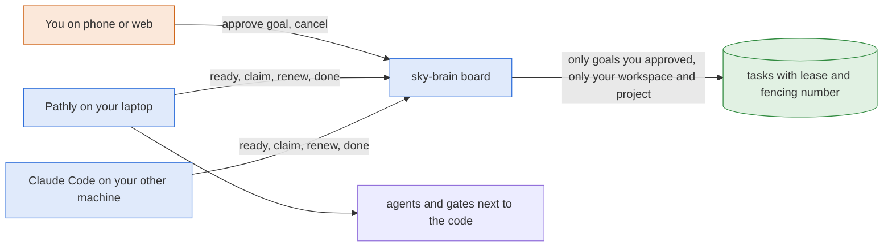
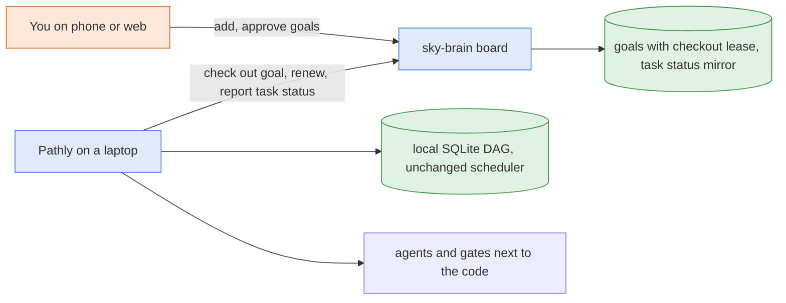
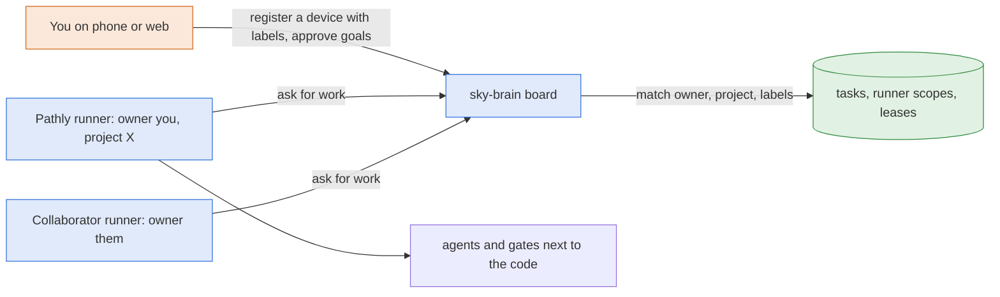
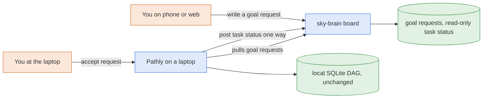

# Brainstorm: cloud-task-board

Picked by: person
Style: blueprint
Type: learn
Scouts: code=normal web=deep
Helpers: architect po skeptic lens=artistic,security

## Idea

shammai: take Pathly to the cloud "without the CLI spawning but with all other abilities", and "the feature-goal-tasks-DAG also should be on the cloud", so allowlisted collaborators share one board. Each person who signs in gets their own workspace (global, project, feature); collaborators are invited.

Already approved in the brief (2026-11-01): goals, tasks, dependencies and task claims move into sky-brain; Pathly, Claude Code and claude.ai pull ready tasks and claim them; the work and the gates stay next to the code; sky-brain never pushes or spawns (D1). The open question this brainstorm answers is how: the shape of the claim protocol, where FSM state lives, how offline and collaborators' goals behave.

## Glossary

- **DAG (directed acyclic graph):** tasks with "must finish before" arrows and no loops. Pathly's goal is split into such tasks. (pathly-adapters `db/queries/comms_tasks.py`)
- **Frontier / ready list:** the pending tasks whose dependencies are all done, so they can start now. (`get_ready_tasks`, same file)
- **Claim:** a worker marking a task as "mine". Pathly does it with one conditional update; whoever changes the row wins. (`claim_task`, comms_tasks.py:161)
- **Pull vs push:** pull means the worker asks the server for work; push means the server sends work to the worker. CI runners all pull over outbound HTTPS, so nothing reaches into your machine. [web] (https://docs.github.com/en/actions/concepts/runners/communicating-with-self-hosted-runners)
- **Lease (visibility timeout):** a claim that lasts a set time. If the worker does not finish or renew it, the task becomes claimable again. [web] (https://docs.aws.amazon.com/AWSSimpleQueueService/latest/SQSDeveloperGuide/sqs-visibility-timeout.html)
- **Heartbeat / renew:** the worker saying "still working" on a timer, which pushes its lease out. [web] (same)
- **Fencing token:** a number that goes up with every new lease. A worker whose lease expired still holds the old number, so its late "done" is refused. [web] (https://martin.kleppmann.com/2016/02/08/how-to-do-distributed-locking.html)
- **SKIP LOCKED:** a Postgres way for many workers to grab the next free row without waiting on each other; pg-boss and Graphile Worker use it. [web] (https://www.postgresql.org/docs/current/sql-select.html)
- **At-least-once:** a task can run twice (for example after a lost lease), so finishing it twice must be harmless. [web] (SQS page above)
- **Runner registration:** a machine is enrolled once by a person on the server, gets its own token tied to that person, and the server, not the machine, decides what it may take. GitLab moved to this after shared tokens leaked. [web] (https://handbook.gitlab.com/handbook/engineering/architecture/design-documents/runner_tokens)
- **Quarantine:** sky-brain holds instruction-like or web text so it is never treated as an instruction until a person releases it. (CLAUDE.md hard rule 6)

## What exists

- sky-brain (branch at brain-core 81697be): actor layer, `resolveScope` with membership in one query, guards for secrets, injection and rate limit (not wired yet), `writeAudit` in the same transaction, PGlite test harness. No `/api/v1` routers yet. [scout] (`apps/server/src/app.ts`, `scope/resolve-scope.ts`, `guards/`)
- PGlite runs one query at a time, so a true claim race can only be proven on real Postgres, for example a CI service container. [scout]
- Pathly: tasks are `comms_messages` rows; claim is compare-and-swap; complete returns newly ready ids; fail marks dependents blocked with a read-then-write that is not atomic; `reclaim_stale_claims` frees every in-progress task at scheduler start, which would steal other machines' claims once there is more than one. [scout] (comms_tasks.py:111-332, comms_task_fail.py:408-456)
- Pathly touches task rows from the query layer, three raw SQL writers (`task_retry.py:64,225`, `blueprints/comms/tasks.py:185`) and the HTTP blueprints; file claims are an in-process dict; `fsm/gates/tasks.py` counts errors as zero unfinished tasks (fail-open). No transaction spans task rows and FSM state. [scout]
- Decision D3 and PLAN section 3 keep tasks local today; hard rule 1 says no endpoint may start, stop or steer a run. [scout]

## Options

All three supersede D3, and a reviewer of each option argued that letting the cloud's board decide what a laptop runs also strains D1 ("a place for context, not for execution") and hard rule 1 ("no endpoint may start, stop or steer a run"). [skeptic] [security] In every option the laptop pulls and nothing reaches into it, but the work it pulls is a prompt for agents that skip permission prompts. That is your call, and option D is the way to avoid it.

### A. Task leases, with the server choosing who may take what (recommended)

The cloud board is the only task store for a linked project. Each worker pulls the ready list and claims one task with a lease and a fencing number, renews it, and reports done or failed. The server filters what each machine sees: only its own workspace and project, and only tasks under goals its own person approved or was assigned. Drafts and held text are never ready. That filter is one piece of C, as a database filter, not a runner registry. [architect]

- Pros: two machines can split one goal's tasks; you see every task move on the phone; a crashed laptop's task comes back by itself. [po] Pathly's scheduler logic stays: only its task-query layer switches to REST for linked projects. [architect]
- Cons: no new claims while offline. A laptop whose lease ran out may still be editing its checkout, so a task can run twice, which means double cost and maybe a double push. [skeptic] [security] The phone board can feel restless; cards need plain words like "on laptop 1" and "came back from laptop 1, no word since 10:42". [artistic] Pathly has three raw SQL writers and a gate that counts errors as zero unfinished tasks; they must go through the query layer and fail closed first. [scout] [architect]
- Size: about 22 tickets in two rounds, plus the Layer 1 pieces it needs (run tokens, T7). [skeptic]
- Risky areas: run tokens; approve, which must be human-only and pin the task text by hash so a changed task cannot run [security]; claim and lease; prompt rendering; file overlap needs a per-project lock inside the claim [architect]; the rate limiter is in memory per instance and polling will hit it [security]; PGlite cannot truly race, so the claim race must be proven on real Postgres in CI. [scout] [architect]

### B. Goal checkout: one machine takes a whole goal

The cloud holds goals and their task DAG. A device checks out a whole approved goal, copies its tasks into Pathly's local board, runs them with today's scheduler, and reports each task's status back one way.

- Pros: smallest change to Pathly; one calm card per goal on the phone, "out with laptop 1 since 10:42". [artistic]
- Cons: two machines cannot split a goal; the cloud copy lags; edits and cancels from the phone never reach a running goal, so you cannot stop a bad goal from the phone [skeptic]; "works offline" contradicts a lease that must be renewed [skeptic]; once copied locally, Pathly's trust-any-local-caller applies and cloud rules stop [security]; the approved brief rules out "local and cloud" for one project. [po] [architect]
- Size: about 12 tickets, plus Layer 1 pieces and the mirror work in pathly-adapters. [skeptic]
- Risky areas: run tokens, checkout fencing on every status report, stale mirrors. [security]

### C. Registered runners: the server hands work to matching machines

Like A, but each device is registered by its person with fixed scopes and labels, and the server hands it the next matching task. This is how GitHub, GitLab and Buildkite runners work. [web]

- Pros: the strongest routing; a "Machines" page answers "why did this task go there?". [artistic]
- Cons: closest to the "cloud runner" D1 rejects by name [skeptic] [security]; a setup step before anything runs [artistic]; collaborator runners lean on Layer 4 sharing that does not exist yet [skeptic]; built for fleets, while you are one builder with a few collaborators. [po]
- Size: about 24 tickets, plus Layer 1 pieces.
- Risky areas: runner registration and scopes, matching, run tokens. [security]

### D. Mirror and local accept: tasks stay in Pathly

Tasks and claims stay in Pathly, as D3 says. Pathly posts goal and task status up as read-only entries you watch on the phone. You can write a "goal request" from the phone, but a laptop starts it only after a person at that laptop accepts it. [skeptic] [security]

- Pros: no change to D1, D3 or hard rule 1; the cloud never decides by itself what runs; the smallest build.
- Cons: two machines cannot split a goal; you cannot start work from the phone alone; claude.ai and Claude Code cannot claim tasks; the board on the phone is a view, not the store, which is less than "the task DAG on the cloud".
- Size: about 8 tickets.
- Risky areas: none new beyond status posting (scan and cap agent writes). [security]

## Consulted

- architect: build A plus server-side eligibility from C as a SQL filter; schema in a new `db/schema/tasks.ts`, logic in `apps/server/src/tasks/`; claim as one conditional update with lazy expiry and a `claim_seq` fencing number; a per-project advisory lock for file overlap; fail and blocking dependents in one transaction; in Pathly, first route the raw writers through the query layer, then swap that layer to REST for linked projects; gates fail closed. Not B, and not B first.
- po: build A, cut down, and cut C. Round one: run tokens with verbs, the tables, the claim protocol, a phone goals page with approve and cancel, a small Pathly adapter, and the eight tests; move the FSM summary, phone edit and reorder, the devices page, the import, the MCP tools and live push later. The proof is approving a three-task goal on the phone and watching Pathly run it.

## Chosen

A, picked by shammai on 2026-11-02: "the goals and tasks and all info of the user project documentation should be on cloud; agents from phone, Claude, Pathly on laptop pull from there." With the architect's server-side eligibility filter and the PO's cut-down first round. shammai accepts that a laptop runs tasks from goals its own person approved in the cloud without confirming again at the laptop; this goes into the new decision with D3.

## Rejected

- B: a lagging cloud copy, no splitting goals, phone edits never reach a running goal; the brief rules out local and cloud for one project.
- C: built for fleets; the eligibility filter from A gives the same protection for one builder and a few collaborators.
- D: the cloud would be only a view, less than the task DAG on the cloud that shammai asked for.

## Risks for the planner

Run tokens, human-only approve with the task text pinned by hash, claim and lease with a fencing number, the per-project lock for file overlap, prompt rendering of task text, the in-memory rate limiter under polling, and proving the claim race on real Postgres in CI.

## Recommendation

A, with the architect's server-side eligibility and the PO's cut-down first round. It is the only option that gives the task DAG on the cloud, with two machines able to split a goal. It needs you to accept, in a new decision, that a laptop may start a task from a goal you approved in the cloud without anyone confirming at that laptop. That approval is yours, pinned to the task text, and only your own devices see your goals. If you would rather keep the cloud from ever choosing what runs, D is the safe alternative.

## Open

- Do you accept a new decision that, beyond D3, narrows D1 and hard rule 1: a laptop pulls and runs tasks from goals its own person approved in the cloud, with nobody confirming at the laptop? [security] [skeptic]
- On the phone, see every task moving live, or one line per goal with which machine has it and when it last reported? [artistic]
- Can Claude propose draft goals (the earlier card; the plan assumes yes).
