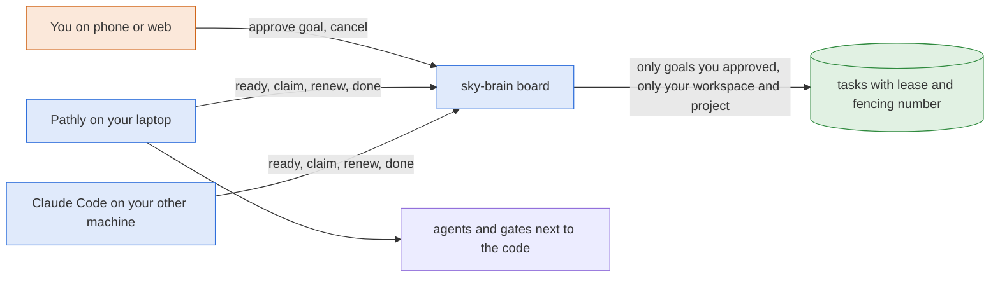

# cloud-task-board — Spec (round one)

Round one of two. Round two (`plans/cloud-task-board-round-two/`, planned after this round
lands and login-mcp is merged) is listed in `map.md`.

## Problem

Pathly keeps each project's goals and task DAG (tasks, dependencies, claims, file claims,
attempts) in a local SQLite board on one laptop. shammai wants to take Pathly to the cloud
"without the CLI spawning but with all other abilities", and "the feature-goal-tasks-DAG also
should be on the cloud", so allowlisted collaborators share one board. Today a second machine,
Claude Code or claude.ai cannot see or take a task, a crashed laptop's claim is only freed when
that same laptop restarts (`reclaim_stale_claims` frees every in-progress task, which would
steal other machines' claims once there is more than one), and decision D3 keeps tasks local.

sky-brain also has no way yet for a headless machine to prove who it is: D8 promises device
login and short-lived run tokens (Layer 1 ticket T7), and nothing implements them.

## Goal and the bar

sky-brain becomes the one authority for each workspace's goals and tasks. A machine is logged in
once with the OAuth device flow, mints run tokens of at most 30 minutes bound to a device,
workspace, project, role and verbs, and with them pulls ready tasks, claims one with a 10-minute
lease, renews it, and reports done (with proof) or failed. sky-brain never contacts a machine.

This plan changes sky-brain only. The Pathly client that makes a linked project use the cloud
board as its only task store is a separate feature-flow plan run inside `pathly-adapters` after
this one (map.md § Follow-up: Pathly client); nothing in this spec depends on that repo.

**The bar (round one).** On a fresh clone,
`pnpm install --frozen-lockfile && pnpm lint && pnpm typecheck && pnpm test` passes, and the
tests prove:

1. two workers racing to claim one ready task: exactly one wins (on PGlite in `pnpm test`, and
   on a real Postgres in CI with `pnpm --filter @sky-brain/server test:pg`);
2. a task with an unfinished dependency is never ready and cannot be claimed;
3. an expired lease returns the task to pending, and the old holder's done is refused;
4. workspace B cannot read, claim or complete workspace A's tasks through any route;
5. two tasks with overlapping files never run at once;
6. an agent cannot create an approved goal (only a `draft`) and cannot approve one, and a device
   never gets a task from a goal it may not run;
7. actor and device on every task event come from the token, never the body;
8. an expired or revoked run token is refused.

**Where this differs from the approved brief.** The brief's bar also has a live half: Pathly on
a laptop runs a three-task goal from the cloud board, and the phone shows each task go pending,
in progress, done with proof. It needs the Pathly client (now the pathly-adapters follow-up
plan) and the web goals page with Google sign-in (round two), so it is not part of this plan's
bar. The plan review moved it out (brief, Decided, plan review round 1), and the user confirmed
this at plan approval on 2026-11-02 (brief, Decided, approval 2). This round's bar is the eight
tested properties above, and the live half is the follow-up's and round two's (R2-10).

Every acceptance criterion below is reachable from this repo with Vitest through the harness in
§ Interfaces; none needs Pathly, a browser or another repo.

## Stories

### A person logs a machine in once

**As a** person, **I want** to log my laptop in with a short code, **so that** Pathly can act
for me without my password or a long-lived secret in a prompt.

- [ ] `POST /api/device/code` with no credential returns a `device_code`, an 8-character
  `user_code` (`XXXX-XXXX`, from `BCDFGHJKLMNPQRSTVWXZ`), `verification_uri`, `expires_in: 900`
  and `interval: 5`.
- [ ] Polling `POST /api/device/token` before approval returns 400
  `{"error":"authorization_pending"}`; polling again sooner than `interval` seconds after the
  last poll returns 400 `{"error":"slow_down"}`; after 900 seconds it returns 400
  `{"error":"expired_token"}`.
- [ ] A person calling `POST /api/v1/devices/approve` with the user code (any case, dash
  optional) and a name creates a device that belongs to them; the next poll returns 200 with a
  `device_token` exactly once, and any later poll with that code returns 400
  `{"error":"invalid_grant"}`.
- [ ] An agent calling approve gets 403 `humans_only`; a wrong or expired user code gets 404
  `not_found`; more than 5 approve calls from one person in 15 minutes get 429 `rate_limited`.
- [ ] `GET /api/v1/devices` lists only the caller's own devices; `POST
  /api/v1/devices/:id/revoke` revokes one of them (another person's device is 404).

### A machine gets short-lived run tokens

**As** Pathly on a laptop, **I want** a token that lasts at most 30 minutes and can do only what
it was minted for, **so that** a leaked token is worth little.

- [ ] `POST /api/v1/run-tokens` with `Authorization: Bearer <device_token>` and
  `{project_id, verbs, role?, ttl_seconds?}` returns 201 with a `run_token`, its `expires_at`
  (at most 1,800 seconds away; default 1,800), the `workspace_id` derived from the project, the
  `role` and the `verbs`.
- [ ] A run token resolves to the agent actor `{kind:"agent", agent_id:"device/<device_id>",
  on_behalf_of:<the device's person>}`.
- [ ] An expired run token, a run token of a revoked device, and a revoked device's device
  token are all refused with 401 `invalid_token` on every `/api/v1` route.
- [ ] A run token calling a route its verbs do not cover gets 403 `verb_not_allowed` (a token
  without `claim` cannot claim); a route not in the verb table (for example `POST
  /api/v1/entries`) gets 403 `verb_not_allowed` too; a device token can only mint.
- [ ] A run token for project A gets 404 `not_found` for any goal or task of project B, even in
  the same workspace.
- [ ] Minting for a project whose workspace has no `members` row for the device's person gets
  404; asking for `role: "editor"` as a viewer gets 403 `role_too_high`.

### A person and their agents put work on the board

**As** a person, **I want** goals that only I approve, **so that** nothing runs on my machines
that I did not see.

- [ ] Any writer (owner or editor; a person, or an agent acting for one) can create a goal with
  `POST /api/v1/goals`; it is always created `draft`. An agent's goal is a draft like anyone
  else's, and an agent sending `assignee` gets 403 `agent_cannot_assign`.
- [ ] Any writer can add tasks to a goal that is not cancelled with `POST
  /api/v1/goals/:id/tasks`; dependencies name earlier tasks of the same request (by index) or
  existing tasks of the same goal (by id).
- [ ] Only a person who is a writer can approve (`POST /api/v1/goals/:id/approve`), cancel and
  release; an agent gets 403 `humans_only` from each, whatever its person's role.
- [ ] Approving pins the text of every task in the goal; a task added or whose text changed
  after approval is not ready and cannot be claimed until the goal is approved again.
- [ ] Nothing under a `draft` or `cancelled` goal is ever ready or claimable.
- [ ] A title, body, file or context ref holding a secret is refused with 422
  `secret_detected` naming the rule, and nothing is stored. Instruction-like title or body text
  is stored with `quarantined_because` set (201); a held goal or task is never ready or
  claimable, an agent never sees it (404 on get, missing from lists), and approve answers 409
  `quarantined` until a person releases it.

### A worker pulls, claims and reports

**As** a worker (Pathly, Claude Code), **I want** to take exactly one ready task at a time and
report it, **so that** no task runs twice on purpose and a crashed worker's task comes back.

- [ ] `GET /api/v1/tasks/ready` lists only `pending` tasks whose dependencies are all `done`,
  under an `approved` goal whose `approved_by` or `assignee` is the caller's person, with no held
  text and with its pinned text unchanged, in the caller's workspace (and the run token's
  project).
- [ ] `POST /api/v1/tasks/:id/claim` on a ready task returns 200 with the task `in_progress`
  and a lease `{claim_seq, expires_at}` 600 seconds ahead; when several workers race for one
  task exactly one gets 200 and the others 409 `already_claimed`.
- [ ] A claim of a task that is not ready (a dependency not done, a draft or cancelled goal, a
  goal the person may not run, held or unpinned text) gets 409 `not_ready`.
- [ ] A claim whose task's `files` overlap a task in progress with a live lease in the same
  project gets 409 `files_busy`; `files: null` or `[]` overlaps everything.
- [ ] Renew, release, done and fail must send the lease's `claim_seq` and come from the same
  actor and device that claimed; otherwise, and after the lease expired, they get 409
  `lease_lost`. Renew and done on a cancelled goal get 409 `goal_cancelled`.
- [ ] A lease not renewed for 600 seconds returns the task to `pending` by itself: reads show
  it `pending` with no holder, it is ready again, and the next claim writes a `reclaimed` event.
- [ ] Done stores the proof (gate results, commit, PR link, summary) and returns the ids that
  became ready; done again with the same `claim_seq` from the same holder is a harmless 200.
- [ ] A claim, and a takeover after an expired lease, leave `attempts` unchanged; only fail
  adds 1 to it.
- [ ] Fail stores the reason and adds 1 to `attempts`; the task goes back to `pending` while the
  new `attempts` is below `max_attempts`, else it becomes `failed` and every task that depends
  on it, directly or not, becomes `blocked`, all in one transaction.
- [ ] A secret in a fail reason or in proof is stored as `[withheld: <rule>]`.
- [ ] Every claim, renew, release, done, fail and reclaim adds a `task_events` row whose actor
  and device come from the token; a body naming an actor or device is refused 400
  `invalid_request` and adds no row.

## Scope

In:
- Device login (RFC 8628 shape) and devices list and revoke as REST routes; run tokens with
  verbs, a run-token resolver, and the device id carried beside the actor.
- Tables `goals`, `tasks`, `task_deps`, append-only `task_events`, `device_codes`,
  `run_tokens`, and a secret hash on `devices`.
- Goals: create (draft), approve, cancel, release, list, get. Tasks: add to a goal, release,
  get, ready, claim, renew, release (give back), done, fail.
- A real Postgres claim race test in CI.
- Docs: decision D19 (or next free), PLAN sections 3, 5, 8, 9 and 13, ROADMAP Layer 1b.

Not in scope (round two unless said otherwise):
- The Pathly client in pathly-adapters (task writers through the query facade; a sky-brain
  client with renew; the linked-project switch for ready, claim, renew, done and fail;
  `reclaim_stale_claims` a no-op and task gates failing closed for linked projects): its own
  feature-flow plan inside pathly-adapters, after this one (map.md § Follow-up: Pathly client).
- The FSM run summary on the board; people's edit, reorder and block of tasks; the devices web
  page and the device approval page; the MCP task tools (`task_next`, `task_claim`,
  `task_done`, `task_fail`, goal and task creation) after login-mcp's `/mcp`; the web goals
  page (needs login-mcp sign-in); live push; the one-shot import of a local Pathly board;
  `pathly brain login` and Pathly's outbox (T10); Pathly picking up newly approved goals by
  itself; a deny button for a device code.
- Run tokens on brain-core's entries routes: the verb table leaves them out (403) until those
  routes check the run token's project (round two, after brain-core 05-11 merge).
- Google sign-in, the allowlist, per-person workspaces and `/mcp`: login-mcp.
- Running anything from the cloud, gates and builds, two-way sync, cost telemetry: never here.

## Happy path

"Pathly" below is any client of these routes; in this round a test (or `curl`) plays it, and
the real Pathly client comes with the pathly-adapters follow-up plan.

1. Pathly calls `POST /api/device/code` → sky-brain returns a user code → Pathly prints it.
2. The person sends `POST /api/v1/devices/approve {user_code, name: "laptop 1"}` (round two adds
   the page) → a device row is created for them.
3. Pathly polls `POST /api/device/token` → gets its `device_token` and stores it (0600).
4. The person (or Claude for them) creates a goal (`draft`) and adds three tasks, task 2 and 3
   depending on task 1 → the person approves the goal → every task's text is pinned.
5. Pathly mints a run token (`verbs: ["read","claim","report"]`, 30 minutes) → `GET
   /api/v1/tasks/ready` returns task 1 → `POST .../claim` returns a lease with `claim_seq` 1.
6. Pathly renews every 180 seconds, runs the task and its gates next to the code, then sends
   `POST .../done {claim_seq: 1, proof}` → sky-brain returns `newly_ready: [task 2, task 3]`.
7. A second laptop of the same person claims task 3 while the first claims task 2, unless their
   files overlap, in which case the second gets 409 `files_busy` and tries again later.
8. Failure path: the first laptop dies with task 2 claimed → 600 seconds later task 2 reads
   `pending` → the second laptop claims it (`reclaimed`, then `claimed`, `claim_seq` 2) → the
   first laptop comes back and sends done with `claim_seq` 1 → 409 `lease_lost`.

## Edge cases

| Trigger | Expected behaviour | Handled in ticket |
|---|---|---|
| Poll faster than `interval` | 400 `slow_down`; the client adds 5 s | 01 |
| User code typed in lower case or without the dash | accepted | 01 |
| Device code used after its token was issued | 400 `invalid_grant` | 01 |
| Person revokes a device mid-run | its device token and every run token it minted get 401 `invalid_token` at once | 01, 02 |
| Person removed from the workspace after minting | run token gets 404 on that workspace's goals and tasks | 02 |
| Token role viewer, or the person is now a viewer | claim, renew, release, done, fail, create get 403 `role_cannot_write` | 02, 04 |
| `depends_on` names a later index, another goal's task or an unknown id | 400 `invalid_request` with `field` `tasks.<i>.depends_on`; nothing stored | 05 |
| Two claims in one project whose files overlap, at the same moment | the per-project advisory lock serializes them; one wins, one gets `files_busy` | 06, 08 |
| Lease expired, any number of times | returns to pending; `attempts` unchanged (only fail counts) | 06 |
| `max_attempts` 3: two leases expire, then one fail | `attempts` 1, task back to `pending`, not `failed` | 07 |
| Goal cancelled while a task runs | the next renew or done gets 409 `goal_cancelled`; fail and release still free the task | 04, 07 |
| Done twice by the same holder with the same `claim_seq` | 200, no second event | 07 |
| Done after the lease expired and someone else claimed | 409 `lease_lost`; the new holder is untouched | 07 |
| Done after the lease expired and nobody claimed yet | 409 `lease_lost` (the lease is gone even though the row still says in progress) | 07 |
| Fail that brings `attempts` to `max_attempts` | task `failed`; transitive dependents `blocked`; one transaction | 07 |

## Design

Option A from the brainstorm, with the architect's server-side eligibility filter and the
product owner's cut-down first round:



Server layout (one file, one concern, under 400 lines each):

- `apps/server/src/devices/`: the anonymous device-flow routes (mounted at `/api/device`, before
  the `/api/v1` actor middleware) and the human devices routes under `/api/v1/devices`.
- `apps/server/src/run-tokens/`: token generation and hashing, the mint route, the resolver that
  turns `sbd_`/`sbr_` bearer tokens into an actor plus a run context, and the verb table.
- `apps/server/src/actor/run-context.ts`: a `WeakMap<Request, RunContext>` beside the actor's,
  read with `runContextOf(req)`; the `Actor` union is unchanged (login-mcp's shape).
- `apps/server/src/tasks/`: goals and tasks routers, the ready query, claim, report
  (renew/release/done/fail), the file-overlap check, the event writer and wire mapping.
- `apps/server/src/db/tasks-schema.ts` and `apps/server/src/db/auth-schema.ts`, re-exported from
  `db/schema.ts` so `drizzle.config.ts` and `db/client.ts` stay as they are.
- `packages/shared/src/tasks.ts`: the zod request schemas and wire types, shared with the web
  page later.

Claim, in one transaction: `pg_advisory_xact_lock(hashtextextended('task-claim:' ||
project_id, 0))`; read the live in-progress tasks of the project and check file overlap; then
one conditional `UPDATE tasks SET status='in_progress', holder..., claim_seq = claim_seq + 1,
lease_expires_at = $now + 600 s WHERE id = $id AND (status = 'pending'
OR (status = 'in_progress' AND lease_expires_at <= $now)) AND <eligibility> RETURNING *`;
then the events (`reclaimed` when the old row was an expired in-progress row, then `claimed`)
and the audit row. Renew, release, done and fail are one conditional `UPDATE ... WHERE id = $id
AND status = 'in_progress' AND claim_seq = $sent AND holder_actor = $actor AND holder_device IS
NOT DISTINCT FROM $device AND lease_expires_at > $now`. Every time comparison uses the app clock
(`createApp({ now })`) passed as a parameter, never SQL `now()`, so tests can move time.

### Decisions

- **Build the device flow in sky-brain now** — options: our own RFC 8628 routes now; wait for
  Better Auth's device authorization plugin that login-mcp brings. Chosen: our own, small. Why:
  the brief puts device login first in round one and login-mcp is not on this branch; the
  routes follow RFC 8628's names and errors so a later swap keeps Pathly's client. Rejected:
  waiting, which blocks every run-token ticket on login-mcp. (Open question for the architect.)
- **Device approval is a human-only REST route in round one** — options: a page now; a route
  now and the page in round two. Chosen: the route. Why: pages need login-mcp's sign-in, and the
  brief moves the devices page to round two.
- **Device credential and run tokens are opaque random tokens stored as SHA-256 hashes** —
  options: JWTs signed by the server; opaque tokens looked up per request. Chosen: opaque. Why:
  revoke must kill them at once (a lookup does; a JWT lives to its expiry), and there are no
  keys to manage before login-mcp. Prefixes `sbd_` (device) and `sbr_` (run) let the resolver
  pick its tokens and leave every other bearer token to login-mcp's resolver.
- **Verbs are `read`, `plan`, `claim`, `report`, checked centrally** — options: a check inside
  each route; one table of method and path to verb, applied in middleware before any router.
  Chosen: the table. Why: it fails closed, so a route nobody listed (brain-core's entries
  routes, which do not yet check a run token's project) refuses run tokens.
- **Approval pins task text by hash computed in the app** — options: a generated column;
  an app-computed `text_hash` written on every insert and update. Chosen: app-computed, one
  function `taskTextHash()`. Why: a spike on PGlite 0.5.14 refused `sha256(convert_to(...))`
  and `array_to_string` in a generated column ("generation expression is not immutable").
- **Approval is per goal, and pins every task under it** — options: approve each task; approve
  the goal. Chosen: the goal, re-approvable. Why: one tap on the phone; a task added or changed
  later stays unpinned until the next approve.
- **Lazy lease expiry with a `claim_seq` fencing number** — options: a sweeper job; lazy expiry
  read at query time. Chosen: lazy (brainstorm decision). Why: no background process, and
  fencing on `claim_seq` plus holder and device refuses a late report.
- **File overlap uses Pathly's rule** — equal paths, or one is a folder of the other, and an
  empty or null list overlaps everything (`supervisor/file_claims.py`). Checked under a
  per-project advisory lock in the claim transaction.
- **Expiry does not count toward `max_attempts`; only fail does** — options: expiry counts as a
  failed attempt; it does not. Chosen: it does not, so `attempts` counts fails: claim and
  takeover leave it alone, and fail sets `attempts = attempts + 1` and compares the new value
  with `max_attempts`. Why: less level-3 logic; a worker that keeps dying shows as many
  `reclaimed` events, which a person can cancel.
- **Quarantined text is hidden from agents, as for entries** — an agent gets 404 for a held
  goal or task and never sees it in lists.
- **Prove the race on real Postgres in a separate Vitest config** — options: `describe.skipIf`
  in the normal run; a `*.pg.test.ts` file excluded from `pnpm test` and run by `test:pg` with
  a CI Postgres service. Chosen: the separate config. Why: no skipped test in the normal run;
  the pg run fails, not skips, without `TEST_DATABASE_URL`.
- **The Pathly client is its own plan** — options: tickets in this plan that change
  pathly-adapters; a separate plan run inside pathly-adapters. Chosen: separate (brief, Decided,
  plan review round 1). Why: the flow's gate, floor guard, test-first proof, lanes and reviews
  all work on this repo's diff only, so tickets in another repo would pass unchecked.

## Interfaces

### How a test reaches the server

As in `plans/brain-core/spec.md` § How a test reaches the server: Vitest, `*.test.ts`, the
harness `apps/server/src/testing/harness.ts` (`createTestDb`, `closeTestDb`, `seedWorkspace`,
`seedProject`, `seedFeature`, `startTestServer({db, now?})`, `server.as(actor)`,
`server.anonymous`). From `plans/cloud-task-board/acceptance/` the harness is
`../../../apps/server/src/testing/harness.ts`. The acceptance command
(`pnpm exec vitest run --root plans/cloud-task-board/acceptance`) uses Vitest defaults, so pass
60-second timeouts to `beforeAll` yourself. Use a mutable clock to move time:
`let t = new Date("2026-11-02T10:00:00Z"); startTestServer({ db, now: () => t })`.

New, in `apps/server/src/testing/task-seeds.ts` (test only; seeds insert rows directly):

```ts
seedGoal(db, { workspaceId: string; projectId: string; featureId?: string; title?: string;
  body?: string; executor?: "single" | "loop" | "team";
  status?: "draft" | "approved" | "cancelled"; approvedBy?: string; assignee?: string;
  authorKind?: "human" | "agent"; author?: string; onBehalfOf?: string;
  quarantinedBecause?: string }): Promise<{ id: string }>
seedTask(db, { goalId: string; title?: string; body?: string; lane?: string;
  files?: string[] | null; dependsOn?: string[]; status?: TaskStatus; maxAttempts?: number;
  pinned?: boolean /* default: true when the goal is approved */;
  quarantinedBecause?: string }): Promise<{ id: string }>
withToken(server: TestServer, token: string): TestClient   // sends Authorization: Bearer <token>
loginDevice(server: TestServer, person: { kind: "human"; user_id: string }, name: string):
  Promise<{ deviceId: string; deviceToken: string }>      // code → approve → token, via routes
mintRunToken(server: TestServer, deviceToken: string, body: { project_id: string;
  verbs: Verb[]; role?: "editor" | "viewer"; ttl_seconds?: number }):
  Promise<{ runToken: string; expiresAt: string }>         // via POST /api/v1/run-tokens
```

`apps/server/src/db/schema.ts` also exports the new Drizzle tables `goals`, `tasks`,
`taskDeps`, `taskEvents`, `deviceCodes` and `runTokens`, so a test may read rows (for example
`db.select().from(taskEvents)`) and may update a task's `title` directly to show that changed
text is no longer pinned. Secret-shaped fixtures are built at run time by joining pieces.

### Wire types (JSON, snake_case)

`Goal`: `id`, `workspace_id`, `project_id`, `feature_id` (or null), `title`, `body`, `executor`
(`single` | `loop` | `team`), `status` (`draft` | `approved` | `cancelled`), `assignee` (user id
or null), `approved_by` (user id or null), `approved_at`, `quarantined_because` (pattern id or
null), `author_kind`, `author`, `on_behalf_of`, `counts` (`{pending, in_progress, done, failed,
blocked}` by effective status), `created_at`, `updated_at`.

`Task`: `id`, `goal_id`, `workspace_id`, `project_id`, `title`, `body`, `lane` (or null),
`files` (string array, or null for "touches everything"), `context_refs` (string array),
`depends_on` (task ids), `status` (effective: `pending` | `in_progress` | `done` | `failed` |
`blocked`; an `in_progress` row whose lease has passed reads `pending`), `attempts` (fails so
far),
`max_attempts` (default 3, 1..10), `holder` (`{actor, device_id, lease_expires_at}` while in
progress with a live lease, else null), `claim_seq`, `pinned` (true when the text matches what
was approved), `quarantined_because`, `proof` (or null), `fail_reason` (or null), `position`,
`created_at`, `updated_at`.

`Proof`: `{gates?: [{name, ok: boolean, summary?}], commit?: string /* 7-64 hex */,
pr_url?: string /* https */, summary?: string}`.

`Verb`: `read` | `plan` | `claim` | `report`, defined once in
`packages/shared/src/run-tokens.ts` (`VERBS`, `Verb`, `verbSchema`) and imported everywhere else.

Errors: `{"error": {"code", "message", "field"?, "rule"?}}`, except the two anonymous device-flow
routes, which answer errors as RFC 8628 does: 400 `{"error": "<code>"}`.

### Routes

"Writer" means the human, or the person the agent acts for, is an owner or editor of the
target's workspace; for a run token, its role must also be `editor`.

| Method and path | Who | Request | Success |
|---|---|---|---|
| `POST /api/device/code` | anyone | `{client_name}` (1..64 chars) | 200 `{device_code, user_code, verification_uri, expires_in: 900, interval: 5}` |
| `POST /api/device/token` | anyone | `{grant_type: "urn:ietf:params:oauth:grant-type:device_code", device_code}` | 200 `{device_token, device_id}` once; else 400 `authorization_pending`, `slow_down`, `expired_token`, `invalid_grant` |
| `POST /api/v1/devices/approve` | human | `{user_code, name}` | 200 `{device: {id, name, created_at, last_seen_at, revoked_at}}` |
| `GET /api/v1/devices` | human | — | 200 `{devices}` (own only) |
| `POST /api/v1/devices/:id/revoke` | human, own device | — | 200 `{device}` |
| `POST /api/v1/run-tokens` | device token | `{project_id, verbs, role?, ttl_seconds?}` (60..1800) | 201 `{run_token, expires_at, workspace_id, project_id, role, verbs, device_id}` |
| `POST /api/v1/goals` | writer; verb `plan` | `{project_id, feature_id?, title, body, executor, assignee?}` | 201 `{goal}` (`draft`) |
| `GET /api/v1/goals` | member; verb `read` | query `project_id` | 200 `{goals}` newest first |
| `GET /api/v1/goals/:id` | member; verb `read` | — | 200 `{goal, tasks}` (tasks by `position`) |
| `POST /api/v1/goals/:id/approve` | human writer | — | 200 `{goal, pinned}` (count of tasks pinned now) |
| `POST /api/v1/goals/:id/cancel` | human writer | — | 200 `{goal}` |
| `POST /api/v1/goals/:id/release` | human writer | — | 200 `{goal}` |
| `POST /api/v1/goals/:id/tasks` | writer; verb `plan` | `{tasks: [{title, body, lane?, files?, context_refs?, depends_on?, max_attempts?}]}` (1..50) | 201 `{tasks}` |
| `GET /api/v1/tasks/ready` | member; verb `read` | query `project_id` (a run token may omit it), `goal_id?`, `limit?` (1..100, default 20) | 200 `{tasks}` (goal oldest first, then `position`) |
| `GET /api/v1/tasks/:id` | member; verb `read` | — | 200 `{task}` |
| `POST /api/v1/tasks/:id/release-text` | human writer | — | 200 `{task}` (clears `quarantined_because`) |
| `POST /api/v1/tasks/:id/claim` | writer; verb `claim` | `{}` | 200 `{task, lease: {claim_seq, expires_at}}` |
| `POST /api/v1/tasks/:id/renew` | the holder; verb `claim` | `{claim_seq}` | 200 `{lease}` |
| `POST /api/v1/tasks/:id/release` | the holder; verb `claim` | `{claim_seq}` | 200 `{task}` (back to `pending`) |
| `POST /api/v1/tasks/:id/done` | the holder; verb `report` | `{claim_seq, proof}` | 200 `{task, newly_ready}` |
| `POST /api/v1/tasks/:id/fail` | the holder; verb `report` | `{claim_seq, reason}` (1..4000 chars) | 200 `{task, blocked}` |

Every request body is strict: an unknown field (for example `actor`, `device_id`, `author`) is
400 `invalid_request`. Every path `:id` must be a uuid, else 400 `invalid_request`.

### Check order

As brain-core's, with the run-token steps added; the first failure answers, and a refused
request stores nothing and writes no event or audit row.

1. Actor: 401 `invalid_token` (an `sbd_`/`sbr_` token unknown, expired, or of a revoked
   device), else brain-core's 401 codes.
2. JSON body: 400 `invalid_json`; 413 `too_large` over 64 KB.
3. Verb (run and device tokens only): 403 `verb_not_allowed`.
4. Humans only (approve, cancel, release, release-text, devices routes): 403 `humans_only`.
5. Rate limit (every `POST` above under `/api/v1`, per actor and device; devices approve: 5 per
   15 minutes per person): 429 `rate_limited` with `Retry-After`.
6. Request shape and size caps: 400 `invalid_request`; 413 `too_large` with `field`.
7. Target and membership: 404 `not_found` when the target does not exist, its workspace has no
   `members` row for the person, a run token's project differs, or the caller is an agent and
   the goal or task is held.
8. Role: 403 `role_cannot_write` for a viewer (or a viewer run token) on any write;
   `agent_cannot_assign` for an agent sending `assignee`; `role_too_high` on mint.
9. State: approve 409 `invalid_state` (cancelled) then 409 `quarantined`; cancel 409
   `invalid_state` (already cancelled); release 409 `invalid_state` (not held); add tasks 409
   `invalid_state` (cancelled goal); claim 409 `files_busy`, `already_claimed` (a live lease is
   held), `not_ready`; renew/release/done/fail 409 `lease_lost`, then renew/done 409
   `goal_cancelled`.
10. Secrets (goal create, add tasks): 422 `secret_detected` with `rule`.
11. Quarantine (goal create, add tasks): stored with `quarantined_because`, 201.

### Size caps

`title` 200 characters; `body` 16,384 UTF-8 bytes; `files` 100 paths of at most 512
characters; `context_refs` 50 of at most 2,048 characters; `tasks` 50 per request; `reason`
4,000 characters; proof `gates` 50, a gate `name` 200, any `summary` 4,000, `pr_url` 2,048.
413 `too_large` with `field` naming the value (`tasks.3.body`, `proof.gates.2.summary`).

### Events and audit

`task_events` (append-only; a trigger raises on `UPDATE`, `DELETE` and `TRUNCATE`): `seq`,
`workspace_id`, `task_id`, `kind` (`created` | `claimed` | `renewed` | `released` | `done` |
`failed` | `reclaimed`), `actor` (`human:<id>` or `agent:<id>`), `on_behalf_of`, `device_id`
(null when the caller has no device token), `claim_seq`, `at` (the app clock), `details` (ids
and states only, never text: `failed` holds `{final, blocked}`, `reclaimed` holds
`{from_actor, from_device, from_claim_seq}`).
`audit_log` rows: `goal.create`, `goal.approve`, `goal.cancel`, `goal.release`, `task.create`,
`task.release_text`, `task.status` (`{from, to, via}`), `device.approve`, `device.revoke`,
`run_token.mint`, written in the same transaction as the change.

## Migration and compatibility

- New tables and one new column (`devices.secret_hash`, nullable); no existing row changes.
  Migrations come from `drizzle-kit generate` plus one custom SQL migration for the
  `task_events` trigger, as `0001_audit-append-only.sql` does for `audit_log`.
- `app.ts` gains the `/api/device` mount and the run-token resolver ahead of
  `options.resolveActor`; other bearer tokens reach the existing resolver unchanged.
  brain-core tickets 05-11 also change `app.ts`, the harness and the schema; whoever merges
  second rebases (map.md).

## Risks

- Run tokens, device flow and approve are the trust boundary — level 3 tickets, tests for the
  allowed and refused case of each.
- A task can run twice after a lost lease (double cost, maybe a double push) — fencing refuses
  the late report; the Pathly follow-up must stop work when renew answers `lease_lost`.
- PGlite runs one transaction at a time, so the `pnpm test` race cannot fail by interleaving —
  ticket 08 runs the race and the overlap check on a real Postgres in CI.
- The rate limiter is in memory per server instance — fine for one Render instance; polling
  `ready` is a read and is not limited.
- Task text goes into agent prompts — it is quarantined like entries, and an agent never sees
  held text; prompt fencing of task text is round two's MCP work.
- Narrowing D1 and hard rule 1 — the docs ticket writes the new decision and the new CLAUDE.md
  hard rule 1 wording, which the user approved at plan approval (brief, Decided, approval 2).
- brain-core 05-11 and login-mcp change the same files — `Shared:` in commands.md builds those
  tickets alone; the map names the rebase.
